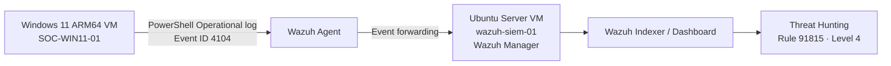

# SOC Investigation #003 — PowerShell Process Discovery

**Hands-on SOC investigation | Windows Event ID 4104 | Wazuh SIEM | MITRE ATT&CK T1057**

## Executive summary

This project documents a **controlled, authorized** PowerShell discovery test on a Windows 11 lab endpoint. PowerShell Script Block Logging recorded the executed commands as **Windows Event ID 4104**. After configuring the Wazuh agent to collect the PowerShell Operational channel, the Wazuh manager received the events and generated a **level 4 alert under rule 91815**, described as **“Powershell executing process discovery.”**

**Disposition:** Expected benign lab activity. The detection validates telemetry and alerting; it does **not** establish compromise.

## Lab architecture



**Environment:** VMware Fusion on Apple Silicon; Windows 11 ARM64 endpoint; Ubuntu Server 24.04 LTS with Wazuh manager, indexer, and dashboard. VM details describe this specific lab, not a production environment.

## Investigation objectives

1. Confirm PowerShell Script Block Logging is enabled.
2. Generate harmless, repeatable PowerShell discovery activity.
3. Verify the corresponding Windows Event ID 4104 locally.
4. Confirm the Wazuh agent collects `Microsoft-Windows-PowerShell/Operational`.
5. Validate alert ingestion and inspect rule metadata and script content.
6. Distinguish observed telemetry from conclusions about intent.

## Controlled test

Executed on `SOC-WIN11-01` in an administrative PowerShell session:

```powershell
$LabMarker = "SOC-INV-003-WAZUH-VALIDATION"
Write-Output $LabMarker
Get-LocalUser | Select-Object Name, Enabled
Get-Process | Select-Object -First 5 Name, Id
```

The marker ties the test to its log entry. `Get-LocalUser` enumerates local accounts; `Get-Process` lists running processes. Neither command, by itself, indicates malicious intent.

## Configuration and validation

Script Block Logging was verified as enabled (`EnableScriptBlockLogging : 1`). The local PowerShell Operational log contained Event ID **4104** with the marker and command text. Initially, a search for 4104 in Wazuh alerts returned no results. Inspection of the Wazuh agent configuration showed the PowerShell channel was not yet in its collection list. The following channel was added to the agent configuration and the agent service restarted:

```xml
<localfile>
  <location>Microsoft-Windows-PowerShell/Operational</location>
  <log_format>eventchannel</log_format>
</localfile>
```

> This is an excerpt, not a complete replacement `ossec.conf`. Back up the existing configuration before editing.

After the change, Wazuh alerts included Windows Event ID 4104. One confirmed test alert had:

| Field | Observed value |
|---|---|
| Agent | `SOC-WIN11-01` |
| Event ID | `4104` |
| Wazuh rule | `91815` |
| Rule description | `Powershell executing process discovery` |
| Severity | Level 4 |
| Alert timestamp (UTC) | `2026-11-23T14:33:49.690+0000` |
| Script Block ID | `91505d99-e924-4d7f-9c9c-ca3d9b3f1d93` |
| MITRE ATT&CK mapping in alert | `T1057` — Process Discovery |

Additional Wazuh rule **91816** alerts were observed for PowerShell scripts querying environment variables, mapped by the rule to **T1082 — System Information Discovery**. Those alerts are contextual observations, not necessarily generated by the marked validation script.

## Evidence

| Image | What it demonstrates |
|---|---|
| [01 — Logging enabled](screenshots/01-PowerShell-ScriptBlock-Logging-Enabled.png) | Script Block Logging policy and local 4104 events |
| [02 — Local test](screenshots/02-PowerShell-Test-Local-Event-4104.png) | First controlled PowerShell test and matching 4104 record |
| [03 — Initial search](screenshots/03-Wazuh-Initial-4104-Search-No-Results.png) | No matching Wazuh alerts before collection fix |
| [04 — Configuration before](screenshots/04-Wazuh-Agent-Config-Before-PowerShell-Collection.png) | Missing PowerShell Operational collection entry |
| [05 — Configuration after](screenshots/05-Wazuh-Agent-Config-PowerShell-Collection-Enabled.png) | Added channel and running Wazuh agent |
| [06 — Wazuh alerts](screenshots/06-Wazuh-4104-Alerts-91815-91816.png) | 4104 alerts and detection rules in manager output |
| [07 — Validation locally](screenshots/07-PowerShell-Validation-Local-Event-4104.png) | Validation marker and full script block in Windows |
| [08 — Event details](screenshots/08-Wazuh-PowerShell-Event-Details.png) | Script block captured in Wazuh indexed document |
| [09 — Detection dashboard](screenshots/09-Wazuh-PowerShell-Detection-Rule-91815.png) | Rule 91815, level 4, endpoint and event in Threat Hunting |

## Analyst assessment

**Finding:** The endpoint generated a script-block event containing process enumeration, and Wazuh ingested and classified it under a process-discovery rule. The source activity was intentionally initiated for this lab. **No evidence here supports an actual intrusion.** In production, an analyst would correlate the command with initiating user, parent process, execution context, host baseline, adjacent activity, and authorization before escalating.

**Important mapping distinction:** T1057 is the rule's relevant process-discovery mapping. A generic 4104 event is not automatically evidence of T1057; the specific script content and alert explain this classification.

## Full report

See [Investigation Report](reports/Investigation-03-PowerShell-Process-Discovery.md) for timeline, triage, limitations, and recommended follow-up.

## Skills demonstrated

Windows event auditing · PowerShell Script Block Logging · Wazuh agent configuration · SIEM ingestion troubleshooting · JSON/`jq` log analysis · MITRE ATT&CK mapping · SOC triage and evidence documentation

## Scope and ethics

All commands were run in a personally controlled lab. Screenshots may reveal lab-only hostnames, local account names, and private IP addresses; review them before public distribution. No secrets or production credentials are intentionally included.
